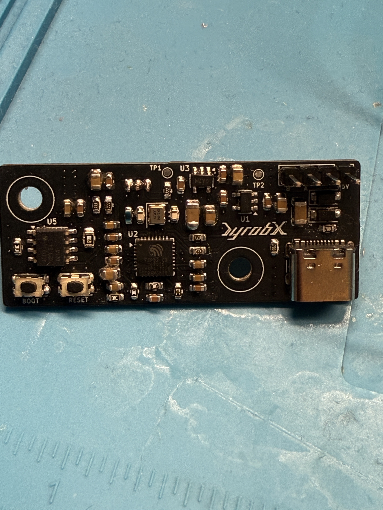
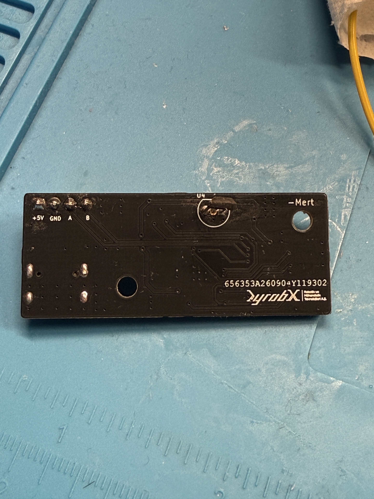
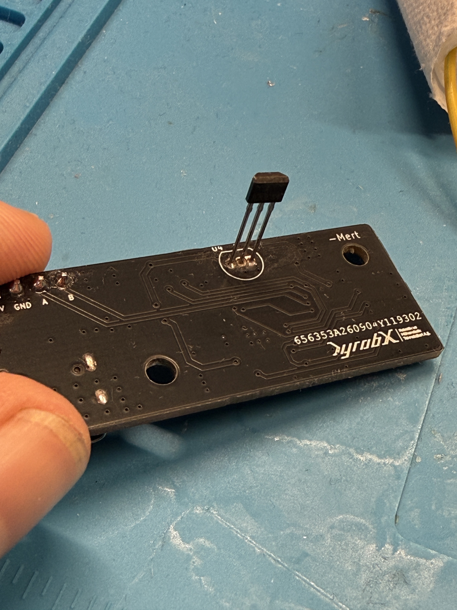

# Filament Kalınlığı Ölçüm Sensör Kartı

DYROBX Robotik kapsamında, filament kalınlığının (çapının) izlenmesine yönelik geliştirdiğim sensör kartı. Proje; Hall sensöründen alınan analog verinin sayısallaştırılmasını, mikrodenetleyici tarafından işlenmesini ve ana kontrol sistemiyle haberleşmesini aynı PCB üzerinde bir araya getiriyor.

**Durum:** Kart tasarımı, PCB üretimi ve komponent dizgisi tamamlandı. Kart devreye alınarak çalışır duruma getirildi.

## Projenin Amacı

Filament çap ölçüm mekanizmasının sensör verisini okuyabilen, kompakt ve ana kontrol sistemine bağlanabilen bir elektronik kart geliştirmek. Tasarımda analog ölçüm zinciri, gömülü kontrol, güç düzenleme ve haberleşme arayüzlerini birlikte ele aldım.

## Donanım Mimarisi

| İşlev | Tasarımda kullanılan yapı |
|---|---|
| Mikrodenetleyici | ESP32-C3 |
| Algılama | DRV5056A3 analog Hall sensörü |
| Sayısallaştırma | MCP3221, 12 bit ADC ve I²C arayüzü |
| Sinyal koşullandırma | Hall çıkışında RC filtre |
| Haberleşme | THVD1420 tabanlı RS485 arayüzü |
| Besleme | USB-C veya harici 5 V giriş; kart üzerinde 3,3 V regülasyon |
| Servis ve programlama | USB-C, BOOT ve RESET butonları |
| Tasarım aracı | KiCad |

Hall sensörünün analog çıkışı filtrelenerek harici ADC üzerinden okunur. ESP32-C3, sayısallaştırılan veriyi işler; RS485 arayüzü ise kartın ana kontrol sistemiyle haberleşmesi için kullanılır. Filament çapına dönüşüm, sensör kartının ölçüm mekanizması ve kalibrasyonuyla birlikte değerlendirilir.

## Kişisel Katkım

- Analog ölçüm, mikrodenetleyici, besleme ve haberleşme bloklarını içeren şematik tasarımı hazırladım.
- PCB yerleşimini ve yönlendirmesini gerçekleştirdim.
- Üretilen kartın komponent dizgisini yaptım ve kartı çalışır duruma getirdim.

Bu çalışma, bir sensör kartını şematik tasarımdan fiziksel donanıma taşıdığım; analog elektronik, PCB tasarımı ve kart devreye alma deneyimimi bir araya getiren tamamlanmış bir projedir.

## Üretilen Kart

<table>
  <tr>
    <th>Ön yüz ve komponent dizgisi</th>
    <th>Arka yüz</th>
    <th>Hall sensörü montajı</th>
  </tr>
  <tr>
    <td></td>
    <td></td>
    <td></td>
  </tr>
</table>

Fotoğraflara tıklayarak tam boyutlu görüntüleri açabilirsiniz.

## Depo İçeriği

- `README.md`: Proje amacı, donanım mimarisi ve kişisel katkım.
- `kart-on-yuz.jpg`: Dizgisi tamamlanan kartın ön yüzü.
- `kart-arka-yuz.jpg`: Kartın arka yüzü.
- `hall-sensor-montaji.jpg`: Hall sensörünün kart üzerindeki montajı.

[Diğer mühendislik projelerim](https://github.com/mertuzun41/Projeler)
